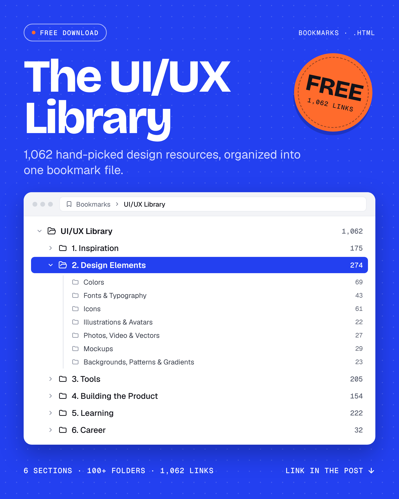

# The UI/UX Library

**1,062 hand-picked UI/UX design resources, organized into one bookmark file.**
Import it into your browser once, and every resource is one click away.

  

  <a href="https://github.com/OSA98/uiux-library/raw/main/UIUX-Library-Bookmarks.zip"><b>⬇️ Download the bookmarks file (.zip)</b></a>

---

## How to import it

1. **Download** [`UIUX-Library-Bookmarks.zip`](https://github.com/OSA98/uiux-library/raw/main/UIUX-Library-Bookmarks.zip) and unzip it. You'll get `UIUX-Library-Bookmarks.html`.
   *Prefer no zip? Open [`UIUX-Library-Bookmarks.html`](UIUX-Library-Bookmarks.html) and click the **Download raw file** button (⬇️) at the top right of the file.*
2. **Import** the `.html` file into your browser:

| Browser | Steps |
|---|---|
| **Chrome** | Press `Ctrl+Shift+O` (Mac: `Cmd+Option+B`) → click **⋮** at the top right → **Import bookmarks** → choose the file |
| **Edge** | Press `Ctrl+Shift+O` → click **⋯** → **Import favorites** → choose *Favorites or bookmarks HTML file* → pick the file |
| **Firefox** | Press `Ctrl+Shift+O` (Mac: `Cmd+Shift+O`) → **Import and Backup** → **Import Bookmarks from HTML** |
| **Safari** | **File** → **Import From** → **Bookmarks HTML File** |

That's it. You'll find a new folder called **UI/UX Library** in your bookmarks.

> Already have bookmarks? Importing doesn't touch them. The library lands in its own folder.

---

## What's inside

| Section | Links | Folders |
|---|---:|---|
| **1. Inspiration** | 175 | General inspiration platforms · Website inspiration · App & screen inspiration · Motion & interactions · Branding & logos · Portfolios & case studies |
| **2. Design Elements** | 274 | Colors · Fonts & typography (incl. Arabic fonts) · Icons · Illustrations & avatars · Photos, video & vectors · Mockups · Backgrounds, patterns & gradients |
| **3. Tools** | 205 | Design & prototyping software · Figma · AI tools · Framer, Webflow & site builders · Motion, video & 3D · Collaboration & planning · Research, testing & analytics · Quick utilities |
| **4. Building the Product** | 154 | Design systems · UI patterns & best practices · UI kits & templates · Components for developers |
| **5. Learning** | 222 | Courses & roadmaps (incl. Arabic courses) · Articles, blogs & books · Psychology & UX laws · Accessibility · UX writing · Practice games & challenges · Design archives · Resource directories · Communities & podcasts |
| **6. Career** | 32 | Jobs, interviews & mentoring · CV & portfolio builders |

Every section is split into subfolders, so you can find what you need in seconds.

---

## Suggest a resource

Know a great resource that's missing, or found a broken link?
[Open an issue](https://github.com/OSA98/uiux-library/issues/new) with the link and where you think it belongs, and it may be added to the next version.

If this library helps you, give the repo a ⭐ and share it with someone learning UI/UX.

---

## بالعربي

مكتبة فيها **1062 مصدر UI/UX** متقسمين على 6 أقسام، في ملف بوك مارك واحد.

**إزاي تستخدمها:**
1. نزّل الملف من [هنا](https://github.com/OSA98/uiux-library/raw/main/UIUX-Library-Bookmarks.zip) وفك الضغط عنه، هتلاقي جواه `UIUX-Library-Bookmarks.html`.
2. في كروم: اضغط `Ctrl+Shift+O` (على الماك `Cmd+Option+B`).
3. من النقط التلاتة فوق على اليمين اختار **Import bookmarks**، واختار الملف.

وخلاص، هتلاقي فولدر جديد اسمه **UI/UX Library** في البوك مارك عندك.

لو عندك موقع شايف إنه لازم يتضاف، افتح [Issue](https://github.com/OSA98/uiux-library/issues/new) وحط فيه الرابط.

